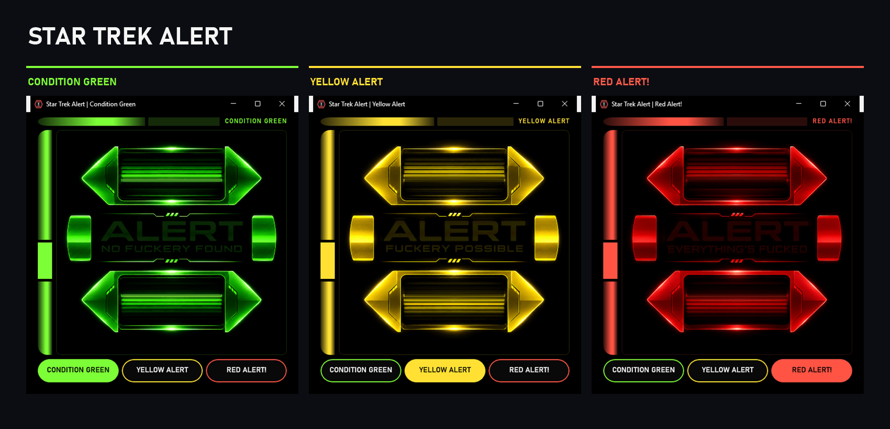

# Star Trek Alert

A WinUI 3 desktop alert panel for Windows x64. Select **Condition Green**, **Yellow Alert**, or **Red Alert!** to play the corresponding animation and update the LCARS colors.



## Run

Download the Windows x64 executable from Releases and open `StarTrekAlert.exe`. Keep the original filename when moving the app.

## Build

Use Windows with the .NET 8 SDK. From the repository root, publish the standalone executable with:

```powershell
dotnet publish StarTrekAlert.csproj -c Release -r win-x64 --self-contained true -p:PublishSingleFile=true -p:IncludeAllContentForSelfExtract=true -p:EnableMsixTooling=true -o publish
```

Open `publish\StarTrekAlert.exe`.
